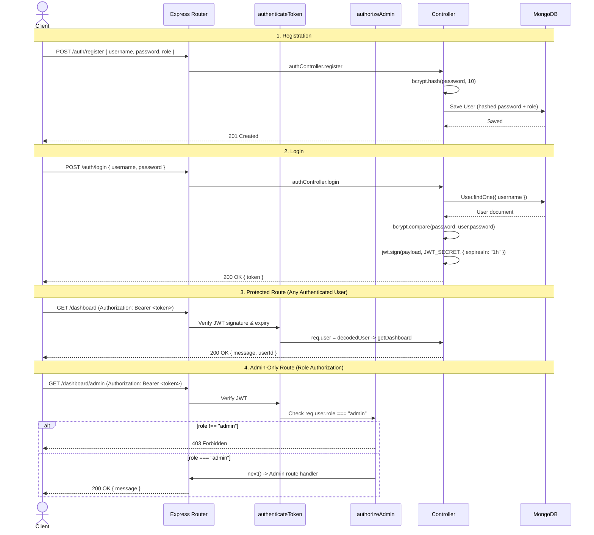

# Express Authentication & Role-Based Authorization API (JWT + bcrypt + MongoDB)

A clean, modular **Node.js + Express + MongoDB** REST API demonstrating user **authentication**, **password hashing with `bcrypt`**, **stateless JSON Web Tokens (`jsonwebtoken`)**, and **role-based authorization (`user` / `admin`)**.


---

## Table of Contents

- [Project Architecture & File Map](#project-architecture--file-map)
- [Tech Stack](#tech-stack)
- [Getting Started](#getting-started)
  - [Prerequisites](#prerequisites)
  - [Installation](#installation)
  - [Environment Variables](#environment-variables)
  - [Running the Server](#running-the-server)
- [Core Concepts: Authentication, JWT, and bcrypt](#core-concepts-authentication-jwt-and-bcrypt)
  - [1. Authentication](#1-authentication)
  - [2. Authorization](#2-authorization)
  - [3. Why We Don't Store Plain Passwords](#3-why-we-dont-store-plain-passwords)
  - [4. Hashing Passwords](#4-hashing-passwords)
  - [5. bcrypt](#5-bcrypt)
  - [6. Salt Rounds](#6-salt-rounds)
  - [7. Hashing a Password (Code)](#7-hashing-a-password-code)
  - [8. Comparing Passwords (Code)](#8-comparing-passwords-code)
  - [9. Session vs. Token Authentication](#9-session-vs-token-authentication)
  - [10. What is JWT?](#10-what-is-jwt)
  - [11. JWT Structure](#11-jwt-structure)
  - [12. Installing JWT](#12-installing-jwt)
  - [13. Creating a JWT (Code)](#13-creating-a-jwt-code)
  - [14. Verifying a JWT (Code)](#14-verifying-a-jwt-code)
- [Codebase Walkthrough (File-by-File)](#codebase-walkthrough-file-by-file)
  - [15. From Simple Express Example to Modular MVC](#15-from-simple-express-example-to-modular-mvc)
  - [`server.js` — Application Entry Point](#serverjs--application-entry-point)
  - [`models/User.js` — Mongoose User Schema](#modelsuserjs--mongoose-user-schema)
  - [`controllers/authController.js` — Register & Login Logic](#controllersauthcontrollerjs--register--login-logic)
  - [`middleware/authMiddleware.js` — JWT Verification Guard](#middlewareauthmiddlewarejs--jwt-verification-guard)
  - [`middleware/adminMiddleware.js` — Role-Based Access Guard](#middlewareadminmiddlewarejs--role-based-access-guard)
  - [`controllers/dashboardController.js` — Protected Route Handler](#controllersdashboardcontrollerjs--protected-route-handler)
  - [`routes/authRoutes.js` & `routes/dashboardRoutes.js` — Routing Layer](#routesauthroutesjs--routesdashboardroutesjs--routing-layer)
- [API Reference & Request Examples](#api-reference--request-examples)
- [Common Mistakes](#common-mistakes)
- [Security Best Practices](#security-best-practices)
- [Mini Assignment Checklist](#mini-assignment-checklist)
- [Review Questions & Answers](#review-questions--answers)

---

## Project Architecture & File Map

```text
auth-main/
├── controllers/
│   ├── authController.js        # Handles user registration (bcrypt) & login (JWT)
│   └── dashboardController.js   # Handles authenticated dashboard response
├── middleware/
│   ├── authMiddleware.js        # Verifies Bearer JWT and sets req.user
│   └── adminMiddleware.js       # Enforces req.user.role === 'admin'
├── models/
│   └── User.js                  # Mongoose schema (username, password, role)
├── routes/
│   ├── authRoutes.js            # /auth/register and /auth/login
│   └── dashboardRoutes.js       # /dashboard and /dashboard/admin
├── .gitignore                   # Excludes node_modules/, .env, logs, OS files
├── package.json                 # Dependencies and npm scripts
└── server.js                    # Express initialization, MongoDB connection, route mounting
```

### End-to-End Request Lifecycle



---

## Tech Stack

| Package | Version (`package.json`) | Purpose |
| :--- | :--- | :--- |
| [`express`](https://expressjs.com/) | `^5.2.1` | Web framework, JSON middleware, routing |
| [`mongoose`](https://mongoosejs.com/) | `^9.3.0` | MongoDB ODM and schema validation |
| [`bcrypt`](https://www.npmjs.com/package/bcrypt) | `^6.0.0` | Adaptive password hashing and comparison |
| [`jsonwebtoken`](https://www.npmjs.com/package/jsonwebtoken) | `^9.0.3` | Signing and verifying JWTs |
| [`dotenv`](https://www.npmjs.com/package/dotenv) | `^17.3.1` | Loads environment variables from `.env` |
| [`nodemon`](https://www.npmjs.com/package/nodemon) *(dev)* | `^3.1.14` | Auto-restarts server on file changes during development |

---

## Getting Started

### Prerequisites

- **Node.js** (v18+ recommended) and **npm**
- **MongoDB** (local instance or MongoDB Atlas connection string)

### Installation

```bash
git clone https://github.com/fafiyusuf/auth.git
cd auth
npm install
```

> To install the core dependencies manually from scratch in a new project:
> ```bash
> npm install express bcrypt jsonwebtoken mongoose dotenv
> ```

### Environment Variables

Create a `.env` file in the root directory (note that `.env` is listed in `.gitignore` and must **never** be committed to version control):

```env
PORT=3000
MONGODB_URI=mongodb://127.0.0.1:27017/auth_tutorial
JWT_SECRET=replace_this_with_a_long_random_cryptographically_strong_secret
```

### Running the Server

```bash
# Production / standard start (runs: node server.js)
npm start

# Development mode with auto-reload (runs: nodemon server.js)
npm run dev
```

When running successfully, the console outputs:

```text
🚀 Server is running on http://localhost:3000
✅ Connected to MongoDB
```

---

## Core Concepts: Authentication, JWT, and bcrypt

### 1. Authentication

**Authentication** is the process of **verifying who the user is**.

- **Example:** Logging in with a username/email and password.
- **Flow:**

```text
User → Login (credentials) → Server verifies credentials → Access granted (token issued) or denied (401)
```

In this codebase, authentication happens in two places:
1. [`controllers/authController.js`](controllers/authController.js) (`login`) verifies the user's password against the stored bcrypt hash and issues a JWT.
2. [`middleware/authMiddleware.js`](middleware/authMiddleware.js) (`authenticateToken`) verifies that incoming requests carry a valid, unexpired JWT.

---

### 2. Authorization

**Authorization** determines **what an authenticated user is allowed to do**.

- **Example:**
  - `admin`: can access `/dashboard/admin` (or perform privileged actions such as deleting users).
  - `user`: can access `/dashboard` (standard profile/dashboard), but is blocked from `/dashboard/admin`.
- **In this codebase:**
  - [`models/User.js`](models/User.js) restricts roles with `enum: ['user', 'admin']` (default `'user'`).
  - [`middleware/adminMiddleware.js`](middleware/adminMiddleware.js) (`authorizeAdmin`) checks `req.user.role === 'admin'` and returns `403 Forbidden` otherwise.

| Concept | Question Answered | Middleware in This Project | Typical Failure Status |
| :--- | :--- | :--- | :--- |
| **Authentication** | *Who are you?* | `authenticateToken` | `401 Unauthorized` (missing token) / `403` (invalid/expired token) |
| **Authorization** | *What can you access?* | `authorizeAdmin` | `403 Forbidden` (insufficient permissions) |

---

### 3. Why We Don't Store Plain Passwords

Storing passwords in plain text is a severe security vulnerability:

```javascript
// NEVER do this!
password = "mypassword123"
```

If the database is leaked, compromised via SQL/NoSQL injection, or exposed through backups, **every user's password is immediately readable**—and attackers will also try those same passwords on users' email, banking, and other accounts (credential stuffing).

---

### 4. Hashing Passwords

**Hashing** transforms a plain-text password into a fixed-format, irreversible string using a cryptographic hash function:

```text
mypassword123  →  $2b$10$ksdfjskdf...
```

Key properties of password hashing:
- **One-way:** You cannot decrypt or reverse a hash back into `"mypassword123"`.
- **Salted:** Adding random per-user data (a salt) ensures two users with the same password produce completely different hashes.
- **Safe for storage:** Even if an attacker obtains the database, recovering original passwords requires expensive brute-force guessing.

---

### 5. bcrypt

`bcrypt` is a battle-tested password hashing library built specifically for passwords (unlike fast general-purpose hashes like MD5 or SHA-256, which GPUs can brute-force billions of times per second).

Install in a Node.js project:

```bash
npm install bcrypt
```

A generated bcrypt hash embeds everything needed to verify it later:

```text
$2b$10$N9qo8uLOickgx2ZMRZoMyeIjZAgcfl7p92ldGxad68LJZdL17lhWy
\__/\/ \____________________/\_____________________________/
 |  |          |                          |
Alg Cost     22-char Salt               31-char Hash
```

---

### 6. Salt Rounds

**Salt rounds** (the cost factor) control how much computational work `bcrypt` performs ($2^{\text{rounds}}$ iterations) when hashing a password:

```javascript
await bcrypt.hash(password, 10); // 10 = salt rounds
```

Higher rounds make hashing exponentially slower, dramatically increasing the cost of brute-force and rainbow-table attacks.

| Salt Rounds | Speed | Security Level | Recommendation |
| :--- | :--- | :--- | :--- |
| `8` | Faster | Lower | Legacy / low-sensitivity testing only |
| `10` | Balanced | Strong | **Most common default** (used in this repo) |
| `12+` | Slower | Very high | High-security environments (benchmark CPU impact) |

---

### 7. Hashing a Password (Code)

#### Standalone Concept Example

```javascript
const bcrypt = require("bcrypt");

const password = "mypassword123";

async function hashPassword() {
  const hash = await bcrypt.hash(password, 10);
  console.log(hash);
}

hashPassword();
```

#### How This Project Implements It ([`controllers/authController.js`](controllers/authController.js))

```javascript
const { username, password, role } = req.body;

// Step 1: Hash the password (10 is the salt rounds)
const hashedPassword = await bcrypt.hash(password, 10);

// Step 2: Create a new user with the hashed password
const newUser = new User({
  username: username,
  password: hashedPassword,
  role: role || 'user'
});

await newUser.save();
```

---

### 8. Comparing Passwords (Code)

Because `bcrypt` uses a unique random salt every time, hashing `"mypassword123"` twice produces two different strings. Therefore, you **never** re-hash and compare with `===`; instead, you use `bcrypt.compare(plainPassword, storedHash)`, which extracts the salt from `storedHash` and checks the result in constant time.

#### Standalone Concept Example

```javascript
const bcrypt = require("bcrypt");

const password = "mypassword123";
const storedHash = "$2b$10$examplehash";

async function checkPassword() {
  const match = await bcrypt.compare(password, storedHash);
  if (match) {
    console.log("Login successful");
  } else {
    console.log("Invalid password");
  }
}
```

#### How This Project Implements It ([`controllers/authController.js`](controllers/authController.js))

```javascript
// Step 1: Find the user in MongoDB
const user = await User.findOne({ username: username });
if (!user) {
  return res.status(401).json({ error: 'Invalid username or password' });
}

// Step 2: Compare the plain text password with the hashed password in DB
const isPasswordValid = await bcrypt.compare(password, user.password);
if (!isPasswordValid) {
  return res.status(401).json({ error: 'Invalid username or password' });
}
```

> Note that returning the exact same message (`'Invalid username or password'`) in both checks prevents attackers from enumerating which usernames exist in the database.

---

### 9. Session vs. Token Authentication

| Feature | Session-Based Auth | Token-Based Auth (JWT) |
| :--- | :--- | :--- |
| **Statefulness** | **Stateful** — Server stores session data in memory, Redis, or DB | **Stateless** — Token holds signed user claims; server needs no session store |
| **Transport** | Usually an `HttpOnly` cookie | Usually `Authorization: Bearer <token>` header |
| **Best Suited For** | Traditional server-rendered websites | REST APIs, SPAs, microservices, mobile apps |
| **Scaling** | Requires shared session store across servers | Scales horizontally effortlessly |

---

### 10. What is JWT?

**JWT** stands for **JSON Web Token** — a compact, URL-safe standard (RFC 7519) for securely transmitting identity claims between a client and a server after login.

Example token format:

```text
xxxxx.yyyyy.zzzzz
```

---

### 11. JWT Structure

A JWT consists of **three Base64Url-encoded parts** separated by dots (`.`):

```text
HEADER.PAYLOAD.SIGNATURE
```

1. **Header (`xxxxx`)**: Metadata about the token — signing algorithm (`"alg": "HS256"`) and token type (`"typ": "JWT"`).
2. **Payload (`yyyyy`)**: Claims / user data embedded in the token (e.g., `userId`, `username`, `role`, plus standard timestamps `iat` and `exp`).
   > **Important:** Header and Payload are Base64Url-*encoded*, **not encrypted**. Anyone who possesses the token can decode and read the payload. Never place passwords or sensitive secrets inside a JWT payload.
3. **Signature (`zzzzz`)**: Cryptographic signature created using the encoded Header, encoded Payload, and your server's `JWT_SECRET`. It proves the token was issued by your server and has not been tampered with.

---

### 12. Installing JWT

```bash
npm install jsonwebtoken
```

---

### 13. Creating a JWT (Code)

#### Standalone Concept Example

```javascript
const jwt = require("jsonwebtoken");
const SECRET = "mysecret";

const token = jwt.sign(
  {
    userId: 1,
    email: "user@email.com",
  },
  SECRET,
  { expiresIn: "1h" }
);

console.log(token);
```

#### How This Project Implements It ([`controllers/authController.js`](controllers/authController.js))

```javascript
const token = jwt.sign(
  {
    userId: user._id,
    username: user.username,
    role: user.role
  },
  process.env.JWT_SECRET,
  { expiresIn: '1h' }
);

res.json({ message: 'Login successful!', token: token });
```

---

### 14. Verifying a JWT (Code)

#### Standalone Concept Example

```javascript
const jwt = require("jsonwebtoken");
const SECRET = "mysecret";

function verifyToken(token) {
  try {
    const decoded = jwt.verify(token, SECRET);
    return decoded;
  } catch (error) {
    return null;
  }
}
```

#### How This Project Implements It ([`middleware/authMiddleware.js`](middleware/authMiddleware.js))

```javascript
const authHeader = req.headers['authorization'];
const token = authHeader && authHeader.split(' ')[1];

if (!token) {
  return res.status(401).json({ error: 'Access denied! Token missing.' });
}

jwt.verify(token, process.env.JWT_SECRET, (err, decodedUser) => {
  if (err) {
    return res.status(403).json({ error: 'Invalid or expired token!' });
  }

  req.user = decodedUser;
  next();
});
```

---

## Codebase Walkthrough (File-by-File)

### 15. From Simple Express Example to Modular MVC

A minimal single-file learning prototype keeps everything in one place (an in-memory `users = []` array, a hardcoded `SECRET`, and inline routes):

<details>
<summary>Click to view the minimal single-file Express prototype for comparison</summary>

```javascript
const express = require("express");
const bcrypt = require("bcrypt");
const jwt = require("jsonwebtoken");

const app = express();
app.use(express.json());

const users = [];
const SECRET = "secretkey";

app.post("/register", async (req, res) => {
  const { email, password } = req.body;
  const hashedPassword = await bcrypt.hash(password, 10);
  users.push({ email, password: hashedPassword });
  res.send("User registered");
});

app.post("/login", async (req, res) => {
  const { email, password } = req.body;
  const user = users.find(u => u.email === email);
  if (!user) return res.status(401).send("User not found");

  const match = await bcrypt.compare(password, user.password);
  if (!match) return res.status(401).send("Wrong password");

  const token = jwt.sign({ email: user.email }, SECRET, { expiresIn: "1h" });
  res.json({ token });
});

function authMiddleware(req, res, next) {
  const token = req.headers.authorization;
  if (!token) return res.status(401).send("Access denied");

  try {
    const verified = jwt.verify(token, SECRET);
    req.user = verified;
    next();
  } catch {
    res.status(401).send("Invalid token");
  }
}

app.get("/dashboard", authMiddleware, (req, res) => {
  res.send("Welcome to the dashboard");
});

app.listen(3000);
```

</details>

This repository upgrades that single-file prototype into a structured, persistent Express application:

| Prototype Limitation | Upgrade in This Codebase |
| :--- | :--- |
| In-memory `users = []` wiped on restart | Persistent MongoDB storage via **Mongoose** ([`models/User.js`](models/User.js)) |
| Hardcoded `SECRET = "secretkey"` | Environment variable `process.env.JWT_SECRET` loaded via `dotenv` ([`server.js`](server.js)) |
| Raw `req.headers.authorization` | Proper `Bearer <token>` parsing with `.split(' ')[1]` ([`middleware/authMiddleware.js`](middleware/authMiddleware.js)) |
| No user roles | Role enum (`'user' \| 'admin'`) + `authorizeAdmin` middleware ([`middleware/adminMiddleware.js`](middleware/adminMiddleware.js)) |
| Single monolithic file | Clean separation into `models/`, `controllers/`, `middleware/`, and `routes/` |
| Uses `email` only | Uses unique `username` + `password` + `role` |

---

### `server.js` — Application Entry Point

- Calls `require('dotenv').config()` first so `MONGODB_URI`, `JWT_SECRET`, and `PORT` are available across all imported modules.
- Registers `app.use(express.json())` so Express parses incoming JSON request bodies into `req.body`.
- Connects to MongoDB using `mongoose.connect(process.env.MONGODB_URI)`.
- Mounts modular routers:
  - `/auth` → [`routes/authRoutes.js`](routes/authRoutes.js) (`/auth/register`, `/auth/login`)
  - `/dashboard` → [`routes/dashboardRoutes.js`](routes/dashboardRoutes.js) (`/dashboard`, `/dashboard/admin`)
- Starts the HTTP server on `process.env.PORT || 3000`.

---

### `models/User.js` — Mongoose User Schema

Defines the structure of user documents stored in MongoDB:

- `username`: `String`, `required: true`, `unique: true` — enforces unique usernames at the database index level.
- `password`: `String`, `required: true` — stores the `bcrypt` hash generated during registration.
- `role`: `String`, `enum: ['user', 'admin']`, `default: 'user'` — enforces valid authorization roles.

---

### `controllers/authController.js` — Register & Login Logic

Exports two async route handlers:

- **`register(req, res)`**
  1. Extracts `{ username, password, role }` from `req.body`.
  2. Hashes the password with `await bcrypt.hash(password, 10)`.
  3. Instantiates and saves a `User` document (`role: role || 'user'`).
  4. Responds with `201 Created` (`{ message: 'User registered successfully!' }`) or `500` if saving fails (such as a duplicate `username`).
- **`login(req, res)`**
  1. Extracts `{ username, password }` from `req.body`.
  2. Queries `User.findOne({ username })`; returns `401` if no matching user exists.
  3. Checks `await bcrypt.compare(password, user.password)`; returns `401` if passwords do not match.
  4. Signs a 1-hour JWT containing `{ userId: user._id, username: user.username, role: user.role }` using `process.env.JWT_SECRET`.
  5. Responds with `{ message: 'Login successful!', token }`.

---

### `middleware/authMiddleware.js` — JWT Verification Guard

Exports `authenticateToken(req, res, next)`:

1. Reads `req.headers['authorization']` (expected format: `Bearer <token>`).
2. Splits on space (`authHeader && authHeader.split(' ')[1]`) to extract `<token>`.
3. If no token is present, stops the request with `401` (`Access denied! Token missing.`).
4. Calls `jwt.verify(token, process.env.JWT_SECRET, ...)`.
5. If verification fails (tampered signature, wrong secret, or expired token), responds with `403` (`Invalid or expired token!`).
6. On success, attaches the decoded payload to `req.user` and calls `next()` so downstream middleware or controllers can identify the user.

---

### `middleware/adminMiddleware.js` — Role-Based Access Guard

Exports `authorizeAdmin(req, res, next)`:

- Runs **after** `authenticateToken` so `req.user` is already populated.
- Checks `req.user && req.user.role === 'admin'`.
- Allows admins through via `next()`; blocks everyone else with `403` (`Access denied! Only admins can do this.`).

---

### `controllers/dashboardController.js` — Protected Route Handler

Exports `getDashboard(req, res)`:

- Reads `req.user.username` and `req.user.userId` set by `authenticateToken` and returns a personalized JSON response without needing another database query.

---

### `routes/authRoutes.js` & `routes/dashboardRoutes.js` — Routing Layer

- [`routes/authRoutes.js`](routes/authRoutes.js) maps public authentication endpoints:
  - `POST /auth/register` → `authController.register`
  - `POST /auth/login` → `authController.login`
- [`routes/dashboardRoutes.js`](routes/dashboardRoutes.js) chains middleware for protected endpoints:
  - `GET /dashboard` → `[authenticateToken]` → `dashboardController.getDashboard`
  - `GET /dashboard/admin` → `[authenticateToken, authorizeAdmin]` → inline admin JSON handler

---

## API Reference & Request Examples

| Method | Endpoint | Auth Required | Role Required | Description |
| :--- | :--- | :--- | :--- | :--- |
| `POST` | `/auth/register` | No | — | Register a new user with hashed password |
| `POST` | `/auth/login` | No | — | Authenticate user and receive a signed JWT |
| `GET` | `/dashboard` | Yes (`Bearer`) | `user` or `admin` | Access authenticated user dashboard |
| `GET` | `/dashboard/admin` | Yes (`Bearer`) | `admin` | Access admin-only protected endpoint |

### 1. Register a User

```http
POST /auth/register
Content-Type: application/json

{
  "username": "alice",
  "password": "mypassword123",
  "role": "user"
}
```

```bash
curl -X POST http://localhost:3000/auth/register \
  -H "Content-Type: application/json" \
  -d '{"username":"alice","password":"mypassword123","role":"user"}'
```

**Response (`201 Created`):**

```json
{
  "message": "User registered successfully!"
}
```

### 2. Log In and Obtain a JWT

```http
POST /auth/login
Content-Type: application/json

{
  "username": "alice",
  "password": "mypassword123"
}
```

```bash
curl -X POST http://localhost:3000/auth/login \
  -H "Content-Type: application/json" \
  -d '{"username":"alice","password":"mypassword123"}'
```

**Response (`200 OK`):**

```json
{
  "message": "Login successful!",
  "token": "eyJhbGciOiJIUzI1NiIsInR5cCI6IkpXVCJ9..."
}
```

### 3. Access Protected Dashboard

```http
GET /dashboard
Authorization: Bearer <TOKEN>
```

```bash
curl http://localhost:3000/dashboard \
  -H "Authorization: Bearer <TOKEN>"
```

**Response (`200 OK`):**

```json
{
  "message": "Welcome to the protected dashboard, alice!",
  "userId": "664f1c2e8f1b2c0012345678"
}
```

### 4. Access Admin Route

```http
GET /dashboard/admin
Authorization: Bearer <TOKEN>
```

```bash
curl http://localhost:3000/dashboard/admin \
  -H "Authorization: Bearer <TOKEN>"
```

- **If `role === "admin"` (`200 OK`):**
  ```json
  { "message": "Welcome to the secret admin area!" }
  ```
- **If `role === "user"` (`403 Forbidden`):**
  ```json
  { "error": "Access denied! Only admins can do this." }
  ```
- **If token is missing (`401 Unauthorized`):**
  ```json
  { "error": "Access denied! Token missing." }
  ```
- **If token is invalid or expired (`403 Forbidden`):**
  ```json
  { "error": "Invalid or expired token!" }
  ```

---

## Common Mistakes

1. **Storing plain-text passwords** instead of cryptographic hashes.
2. **Using weak or hardcoded JWT secrets** (e.g., `"secretkey"` inside source files instead of `process.env.JWT_SECRET`).
3. **Omitting token expiration** (`expiresIn`), leaving stolen tokens valid indefinitely.
4. **Forgetting to strip the `Bearer ` prefix** before calling `jwt.verify()`.
5. **Putting sensitive data in the JWT payload** (remember: payloads are Base64Url-encoded, not encrypted).
6. **Allowing self-assigned `admin` roles in production** — this tutorial accepts `role` in `POST /auth/register` so you can easily test both `user` and `admin` flows; in a production app, public registration should always hardcode `role: 'user'` and assign elevated roles via an authenticated admin workflow.

---

## Security Best Practices

- **Always hash passwords** using `bcrypt` (10+ salt rounds) before persisting to the database.
- **Use strong, high-entropy secrets** stored in `.env` (for example, generated with `node -e "console.log(require('crypto').randomBytes(64).toString('hex'))"`).
- **Keep `.env` out of Git** (already configured in `.gitignore`).
- **Always set token expiration** (e.g., `{ expiresIn: '1h' }`), and pair short-lived access tokens with refresh tokens for long-lived sessions.
- **Always serve over HTTPS** in production so credentials and `Authorization: Bearer` headers cannot be intercepted on the network.
- **Validate input payloads** (e.g., reject missing `username`/`password` with `400 Bad Request` before calling `bcrypt.hash` or database queries).

---

## Mini Assignment Checklist

This repository implements all requirements of the Authentication API mini assignment:

- [x] **Register route** — `POST /auth/register` ([`routes/authRoutes.js`](routes/authRoutes.js))
- [x] **Login route** — `POST /auth/login` ([`routes/authRoutes.js`](routes/authRoutes.js))
- [x] **bcrypt password hashing** — `bcrypt.hash(password, 10)` & `bcrypt.compare(...)` ([`controllers/authController.js`](controllers/authController.js))
- [x] **JWT token generation** — `jwt.sign(..., { expiresIn: '1h' })` ([`controllers/authController.js`](controllers/authController.js))
- [x] **Protected route** — `GET /dashboard` protected by `authenticateToken` ([`routes/dashboardRoutes.js`](routes/dashboardRoutes.js), [`middleware/authMiddleware.js`](middleware/authMiddleware.js))
- [x] **Role-based access (`admin` / `user`)** — User schema `role` enum + `authorizeAdmin` on `GET /dashboard/admin` ([`models/User.js`](models/User.js), [`middleware/adminMiddleware.js`](middleware/adminMiddleware.js))

---

## Review Questions & Answers

<details>
<summary><strong>1. What is authentication?</strong></summary>

Authentication is the process of verifying **who** a user is (for example, checking a submitted username/email and password against stored credentials during login, or verifying a valid JWT on subsequent requests).

</details>

<details>
<summary><strong>2. What is authorization?</strong></summary>

Authorization determines **what** an authenticated user is permitted to do or access based on their roles or permissions (for example, allowing an `admin` to access `/dashboard/admin` while denying a regular `user` with `403 Forbidden`).

</details>

<details>
<summary><strong>3. Why do we hash passwords?</strong></summary>

Because storing plain-text passwords means any database leak immediately exposes every user's credentials. Hashing converts passwords through a one-way cryptographic function so the original password cannot be reversed from the stored database value.

</details>

<details>
<summary><strong>4. What are the 3 parts of a JWT?</strong></summary>

A JWT is formatted as `HEADER.PAYLOAD.SIGNATURE`:
1. **Header:** Signing algorithm (`alg`) and token type (`typ`).
2. **Payload:** Encoded user claims/data (such as `userId`, `username`, `role`, and `exp`).
3. **Signature:** Cryptographic signature computed with the server's secret key to verify authenticity and prevent tampering.

</details>

<details>
<summary><strong>5. What do salt rounds do?</strong></summary>

Salt rounds (the cost factor in `bcrypt.hash(password, 10)`) control how many computational iterations `bcrypt` executes ($2^{\text{rounds}}$). More rounds make each hash slower to compute, which significantly slows down offline brute-force attacks while keeping normal logins fast enough at balanced values like `10`.

</details>
